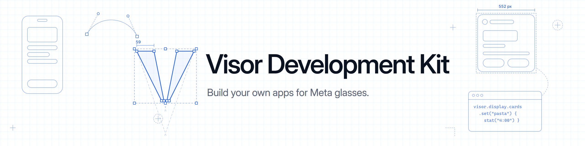

<p align="center">
  
</p>

<p align="center">
  <b>Build apps, scripts, AI agents and Display web apps for Meta glasses.</b><br>
  Through <a href="https://github.com/macedonga/visor">Visor</a>, with the wearer's consent. No Meta account, no Meta AI app, no developer review.
</p>

<p align="center">
  <a href="https://visor.macedonga.com/developers/docs/"></a>
  <a href="https://visor.macedonga.com/developers/docs/getting-started/"></a>
  <a href="https://visor.macedonga.com/developers/docs/compatibility/"></a>
  <a href="LICENSE"></a>
</p>

<p align="center">
  <a href="#what-you-can-build">Features</a> |
  <a href="#quick-start">Quick start</a> |
  <a href="#test-without-the-glasses">Testing</a> |
  <a href="#documentation">Docs</a> |
  <a href="#packages">Packages</a>
</p>

---

The Visor Development Kit (VDK) lets your code use Ray-Ban Meta glasses, the Meta Ray-Ban Display and the Meta
Neural Band through [Visor](https://github.com/macedonga/visor), the open Android app that runs them in place of
Meta AI. Visor holds the glasses' link and speaks their protocol; the VDK hands that to your app, your script, your
agent or your web app, and the person decides what each one may do. Nothing is sent anywhere.

## What you can build

| Area | What you can do |
|---|---|
| **Glasses** | Read the link, battery, model and firmware, and whether the glasses are worn, folded or recording, as it changes. See every pair set up in Visor and switch the active one. Follow the glasses' motion and every touch and press. |
| **Camera** | Take a photo straight into the phone's gallery. Start and stop videos and hyperlapses. Stream the camera live, up to 1080p over Wi-Fi Direct, with the microphones. Import what is on the glasses. |
| **Display** | Show layouts with text, images, icons, buttons and video, and get the clicks. Keep cards of your own on the Display home's Briefing, beside Meta's weather and stocks, with details, pages, charts, buttons and live updates. Put a script on the teleprompter, and notifications on the Display. |
| **Web apps** | Use every part of the VDK from JavaScript in a web app on the Display, and give the wearer's assistant the page's own tools. |
| **Neural Band** | Receive every gesture, with the band left on the Display. Make it vibrate. With the band shared with the phone, read its motion on the wrist too. |
| **Voice** | Answer the questions that name your app, in the glasses' own voice, or start your app with a phrase. Have the glasses say a line unasked. Turn what the glasses hear into text, live. |
| **Assistant** | Give the assistant's model your app's tools, which it calls while it answers the wearer. Read every question and answer. |
| **Settings** | Read every setting the glasses keep, and change the everyday ones. |

Programs and AI agents reach the glasses over the network too, through JSON-RPC or MCP, with a token the person
makes for them, and Visor can post events to a webhook.

## How it works

```mermaid
flowchart LR
    app["Your Android app"] -- "VDK library" --> visor
    computer["Your computer"] -- "adb, JSON-RPC" --> visor
    agents["Programs and AI agents"] -- "WebSocket, MCP" --> visor
    web["A web app on the Display"] -- "the Display's browser" --> visor
    visor(["Visor, on the phone"]) -- "Bluetooth, Wi-Fi Direct" --> glasses["Glasses and Neural Band"]
```



Every capability is a **method**, a **topic** (a stream of events) or a **feed** (a stream of binary records), the
same from every language. The person grants each app its **scopes** in Visor, and can take them back at any time.

## Quick start

> [!NOTE]
> The libraries are in development and not on Maven Central, npm or PyPI yet: build them from this repo.

### Android

```kotlin
dependencies {
    implementation("com.macedonga.visor:kit:0.1.0")
}
```

```kotlin
val visor = Visor.connect(context)

val ask = registerForActivityResult(RequestScopes()) { held -> /* the scopes the app holds now */ }
ask.launch(setOf(Scope.CAMERA, Scope.BAND))

visor.band.gestures.collect { gesture ->
    if (gesture.derived == GestureAction.DOUBLE_TAP) visor.camera.takePhoto()   // the photo lands in the gallery
}
```

### A card on the Display's home

```kotlin
visor.display.cards.set("pasta", "Kitchen timer", LayoutIconName.CLOCK) {
    header(LayoutIconName.CLOCK, "Kitchen timer")
    stat("4:00", "Pasta")
    progress(0.6)
    detail { buttons { button("stop", "Stop") { toast = "Stopped" } } }
}
```

### Python and TypeScript

```python
async with await visor_kit.connect_adb() as visor:
    print(await visor.call("glasses.status"))
    async for gesture in visor.subscribe("band.gestures"):
        print(gesture["finger"], gesture["derived"])
```

```ts
const visor = await Visor.connect("ws://192.168.1.20:7333/rpc", token);
visor.subscribe("band.gestures", {}, (gesture) => console.log(gesture));
```

### A web app on the Display

```ts
import { Visor, onGlasses } from "visor-kit";

if (onGlasses()) {
  const visor = await Visor.connectGlasses();
  await visor.call("voice.speak", { text: "Hello from the web app" });
}
```

The [getting started guide](https://visor.macedonga.com/developers/docs/getting-started/) goes through an Android app step by step.

## Test without the glasses

The `visor` command reaches Visor on the phone through adb, once Developer mode is on in Visor. Call any method,
watch any stream, see your app's traffic, and stand in for the glasses or the band:

```
visor status                              # Visor, the glasses, the band, the apps that use the VDK
visor trace                               # every call and event between your app and Visor
visor simulate band.gestures              # no band needed: type "index double_tap", your app gets it
visor grant com.example.app camera band   # skip the consent screen while you develop
visor card card.json                      # put a card on the Display's Briefing from a file
```

No phone at hand: `visor fake` runs a fake Visor on your computer, with a Display simulator in the browser that
draws your layouts and your Briefing cards. In unit tests, `FakeVisor` runs Visor inside your app's process. Both
are in [Testing](https://visor.macedonga.com/developers/docs/testing/).

## Documentation

- [Overview](https://visor.macedonga.com/developers/docs/overview/): what the VDK is, how it compares with Meta's toolkit, and the roadmap
- [Getting started](https://visor.macedonga.com/developers/docs/getting-started/), [Scopes and consent](https://visor.macedonga.com/developers/docs/scopes-and-consent/),
  [The connection](https://visor.macedonga.com/developers/docs/connection/)
- Capabilities: [Glasses](https://visor.macedonga.com/developers/docs/glasses/), [Camera and captures](https://visor.macedonga.com/developers/docs/camera-and-captures/),
  [Neural Band](https://visor.macedonga.com/developers/docs/neural-band/), [Display](https://visor.macedonga.com/developers/docs/display/), [Briefing cards](https://visor.macedonga.com/developers/docs/briefing-cards/),
  [Web apps on the Display](https://visor.macedonga.com/developers/docs/web-apps/), [Voice and the assistant](https://visor.macedonga.com/developers/docs/voice-and-assistant/),
  [Settings](https://visor.macedonga.com/developers/docs/settings/)
- [Errors](https://visor.macedonga.com/developers/docs/errors/), [Testing](https://visor.macedonga.com/developers/docs/testing/), [Compatibility](https://visor.macedonga.com/developers/docs/compatibility/)
- Other languages: [JSON-RPC](https://visor.macedonga.com/developers/docs/json-rpc/), [The network door](https://visor.macedonga.com/developers/docs/network/)
- [Porting from Meta's DAT](https://visor.macedonga.com/developers/docs/porting-from-dat/)
- [AI tools](https://visor.macedonga.com/developers/docs/ai-tools/): the docs search, its MCP server, and guidance for coding assistants

## Packages

| Package | What it is |
|---|---|
| `com.macedonga.visor:kit` | The Android library. |
| `com.macedonga.visor:kit-testing` | `FakeVisor` for an app's tests, with the Display preview. |
| `com.macedonga.visor:kit-fake` | `FakeVisor` in plain Kotlin, for JVM tests and tools. |
| `com.macedonga.visor:kit-server` | The server engine Visor and FakeVisor share. |
| `com.macedonga.visor:kit-protocol` | The wire contract, for JVM tools and for Visor itself. |
| `visor` | The command for your computer, on the [releases](https://github.com/macedonga/visor-kit/releases) page. |
| [`visor-kit` for TypeScript](clients/typescript) | For browsers, Node and web apps on the Display. |
| [`visor-kit` for Python](clients/python) | For scripts, over adb or the network. |

An app built against any VDK release keeps working with every later Visor, and a newer app works with an older
Visor as far as that Visor goes. The build enforces this against the last release: see
[Compatibility](https://visor.macedonga.com/developers/docs/compatibility/).

## License

Apache 2.0. Visor itself is AGPL-3.0; the VDK is separate so that any app can use it.
