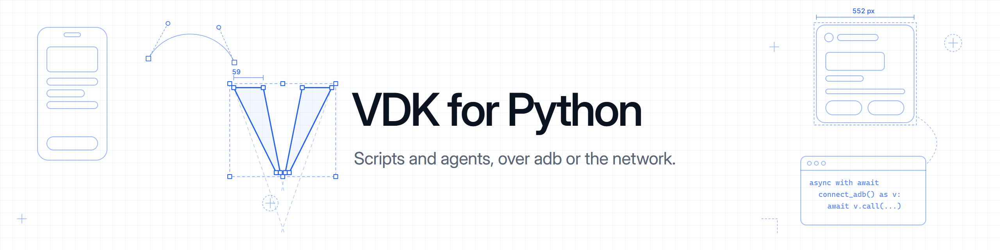

<p align="center">
  
</p>

<p align="center">
  <b>The Visor Development Kit in Python.</b><br>
  Meta glasses from your scripts and agents, over adb or the network, through <a href="https://visor.macedonga.com">Visor</a>.
</p>

<p align="center">
  <a href="https://pypi.org/project/visor-kit/"></a>
  <a href="https://visor.macedonga.com/developers/docs/"></a>
  <a href="https://github.com/macedonga/visor-kit/blob/main/LICENSE"></a>
</p>

<p align="center">
  <a href="#install">Install</a> |
  <a href="#connect">Connect</a> |
  <a href="#use-it">Use it</a> |
  <a href="#layouts-and-briefing-cards">Layouts</a> |
  <a href="#test-without-the-glasses">Testing</a>
</p>

---

Call any method of the VDK, follow its topics and read its feeds: the glasses' status, the camera, the Display,
the Neural Band, voice and the assistant. All of it is `asyncio`.

## Install

```
pip install visor-kit              # over adb
pip install "visor-kit[network]"   # also the network door and visor fake
```

From a clone of visor-kit: `pip install "./clients/python[network]"`.

## Connect

```python
import asyncio
import visor_kit

async def main():
    async with await visor_kit.connect_adb() as visor:
        print(await visor.call("glasses.status"))
        async for gesture in visor.subscribe("band.gestures"):
            print(gesture["finger"], gesture["derived"])

asyncio.run(main())
```

| Connect with | What it needs | Scopes |
|---|---|---|
| `connect_adb(serial=None)` | adb, and Developer mode on in Visor | Every scope |
| `connect_network("ws://127.0.0.1:7333/rpc", token)` | A client the person made in Visor's Advanced settings, under Network access, and the network extra | That client's |
| `connect_fake()` | `visor fake` running on this computer, and the network extra | The ones the fake grants |

## Use it

- `call(method, params)` returns the result.
- `subscribe(topic, params)` yields events, and subscribes when the iteration starts.
- `open(topic, params)` subscribes first and returns a `Stream` to iterate and `aclose()`, for events that follow
  something you do.
- `feed(name, params)` yields a feed's records as `(header, payload)`, the payload as bytes.
- `supports(name)` says whether this Visor answers a method, topic or feed; `welcome` holds its whole hello.

All of them raise `VisorError`, whose `code` and `reason` are the VDK's. Every method and topic works this way, by
its name, with the scopes the connection holds. The [JSON-RPC docs](https://visor.macedonga.com/developers/docs/json-rpc/)
list them all, and [`openrpc.json`](https://github.com/macedonga/visor-kit/blob/main/protocol/api/openrpc.json)
describes them for tools.

## Layouts and Briefing cards

`visor_kit.layout` builds layouts and Briefing cards for the Display as plain dicts, with the same pieces as the
Kotlin builder. Fields take snake_case: `max_lines=1` is `maxLines`.

```python
from visor_kit.layout import card, header, stat, progress, page, chart, field

await visor.call("display.cards.set", card(
    "pasta", "Kitchen timer",
    header("Kitchen timer", icon="clock"),
    stat("4:00", "Pasta"),
    progress(0.6),
    icon="clock",
    pages=[page(field("Started", "19:42")), page(chart([20, 60, 95, 100]))],
))
```

It has `column`, `row`, `text`, `image`, `icon`, `button`, `buttons`, `video`, `chart`, `pager` and `page`, and the
blocks `header`, `stat`, `change`, `field` and `progress`. `image_file(path)` turns a photo into a `data:` URI for
`image()`; Visor scales it to the Display.

## Test without the glasses

`visor fake` runs a fake Visor on your computer, with a Display simulator in the browser that draws your layouts and
cards. Connect to it with `connect_fake()`. Install the command with one line:

```
curl -fsSL https://visor.macedonga.com/install.sh | sh          # macOS and Linux
irm https://visor.macedonga.com/install.ps1 | iex               # Windows
```

## Docs

- [The network door](https://visor.macedonga.com/developers/docs/network/): tokens, scopes and MCP
- [Testing](https://visor.macedonga.com/developers/docs/testing/): the `visor` command and `visor fake`
- [AI-assisted development](https://visor.macedonga.com/developers/docs/ai-tools/): a prompt that sets up your agent
- [All the docs](https://visor.macedonga.com/developers/docs/)

## License

Apache 2.0.
