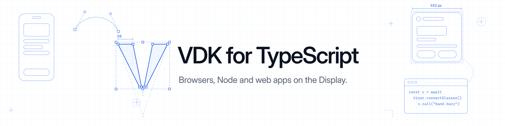

<p align="center">
  
</p>

<p align="center">
  <b>The Visor Development Kit in TypeScript and JavaScript.</b><br>
  Meta glasses from browsers, Node and web apps on the Meta Ray-Ban Display, through <a href="https://visor.macedonga.com">Visor</a>.
</p>

<p align="center">
  <a href="https://www.npmjs.com/package/visor-kit"></a>
  <a href="https://visor.macedonga.com/developers/docs/"></a>
  <a href="https://github.com/macedonga/visor-kit/blob/main/LICENSE"></a>
</p>

<p align="center">
  <a href="#install">Install</a> |
  <a href="#connect">Connect</a> |
  <a href="#use-it">Use it</a> |
  <a href="#layouts-and-briefing-cards">Layouts</a> |
  <a href="#test-without-the-glasses">Testing</a>
</p>

---

Call any method of the VDK, follow its topics and read its feeds: the glasses' status, the camera, the Display,
the Neural Band, voice and the assistant. The person decides in Visor what each client may do.

## Install

```
npm install visor-kit
```

Node 22 or later, any modern browser, or the Display's own browser. From a clone of visor-kit:
`npm install ./clients/typescript`, after `npm run build` there.

## Connect

```ts
import { Visor, onGlasses } from "visor-kit";

const visor =
  onGlasses() ? await Visor.connectGlasses()                              // a web app on the Display
  : token     ? await Visor.connect("ws://192.168.1.20:7333/rpc", token)  // Visor's network door
  :             await Visor.connectFake();                                // visor fake on this computer
```

| From | Connect with | What it needs |
|---|---|---|
| A web app on the Display | `connectGlasses()` | The person allows the app in Visor, Settings > Apps. Until then it rejects with `refused` and reason `not_allowed`. |
| A program or a page | `connect(url, token)` | A program the person added in Visor, under Settings, Apps, Programs and agents. It holds the scopes they gave it. |
| Your computer, with no phone | `connectFake()` | `visor fake` running. |

## Use it

```ts
console.log(await visor.call("glasses.status"));

const gestures = visor.subscribe("band.gestures", {}, (g) => console.log(g.finger, g.derived));
gestures.close();

if (visor.supports("band.motion")) {
  visor.subscribe("band.motion", { rateHz: 30 }, (sample) => draw(sample.orientation));
}
```

- `call(method, params)` resolves with the result, or rejects with a `VisorError` whose `code` and `reason` are the
  VDK's, such as `scope_denied` or `not_connected`.
- `subscribe(topic, params, onEvent, onEnd)` calls `onEvent` for each event until `close()` or the stream ends.
- `feed(name, params, onRecord, onEnd)` brings a feed's records, such as `camera.live`, as a header and bytes.
- `supports(name)` says whether this Visor answers a method, topic or feed.
- `welcome` holds Visor's answer to the hello: its version, what it answers, and the scopes this client holds.

Every method and topic of the VDK works this way, by its name. The [JSON-RPC docs](https://visor.macedonga.com/developers/docs/json-rpc/)
list them all, with their params and answers.

## Layouts and Briefing cards

`visor-kit/layout` builds layouts and Briefing cards for the Display, as the Kotlin builder does:

```ts
import { card, header, stat, change, page, chart } from "visor-kit/layout";

await visor.call("display.cards.set", card("stocks", "My stocks", [
  header("My stocks", "chart_line"),
  stat("27,012.40"),
  change("+1.8%", true),
], { icon: "chart_line", pages: [page([chart([26.1, 26.4, 26.7, 27.0])])] }));
```

It has every element (`column`, `row`, `text`, `image`, `icon`, `button`, `buttons`, `video`, `pager`, `chart`) and
the building blocks `header`, `stat`, `change`, `field` and `progress`. See
[Briefing cards](https://visor.macedonga.com/developers/docs/briefing-cards/).

## Test without the glasses

`visor fake` runs a fake Visor on your computer, with a Display simulator in the browser that draws your layouts and
cards. Connect to it with `Visor.connectFake()`. Install the command with one line:

```
curl -fsSL https://visor.macedonga.com/install.sh | sh          # macOS and Linux
irm https://visor.macedonga.com/install.ps1 | iex               # Windows
```

## Docs

- [Web apps on the Display](https://visor.macedonga.com/developers/docs/web-apps/): `connectGlasses()`, and the
  page's own tools for the wearer's assistant
- [The network door](https://visor.macedonga.com/developers/docs/network/): tokens, scopes and MCP
- [AI-assisted development](https://visor.macedonga.com/developers/docs/ai-tools/): a prompt that sets up your agent
- [All the docs](https://visor.macedonga.com/developers/docs/)

## License

Apache 2.0.
